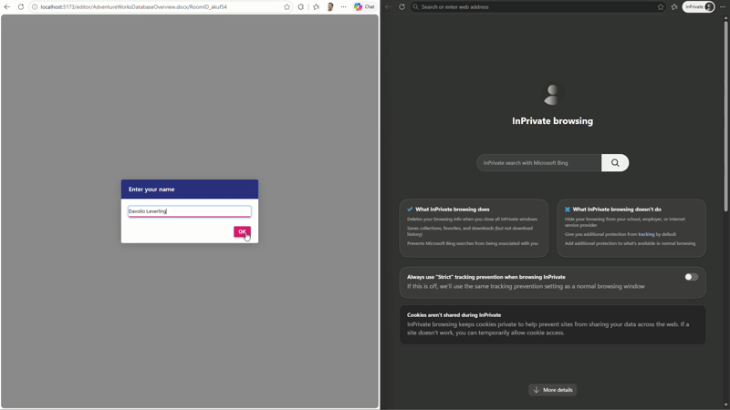

# React DOCX Editor with Collaborative Editing and AI Assistance

## Introduction

This repository contains an example of implementing **real-time collaborative editing** with **AI-powered document assistance** using the Syncfusion<sup style="font-size:70%">&reg;</sup> [React DOCX Editor](https://www.syncfusion.com/docx-editor-sdk/react-docx-editor?utm_source=github&utm_medium=listing&utm_campaign=github-github-documenteditor-examples) (Document Editor).

The sample demonstrates how multiple users can simultaneously edit the same Word document while leveraging Azure OpenAI to generate content directly within the editor. Document changes are synchronized in real time across all connected users through SignalR and Azure Redis Cache, while documents are securely stored in Azure Blob Storage.

This sample showcases the integration of modern cloud services with the Syncfusion Document Editor to build an intelligent, collaborative document editing solution.

### Key Features

* Real-time collaborative editing
* AI-assisted document content generation
* Azure OpenAI integration
* Azure Blob Storage document management
* Azure Redis Cache synchronization
* SignalR-based live collaboration
* Document import and management
* Rich Word document editing experience

---

# How to Run the Application

## Prerequisites

Before running the sample, ensure the following software and services are available:

### Development Environment

* .NET 10 SDK
* Node.js (LTS)
* npm

### Azure Services

* Azure Blob Storage
* Azure Redis Cache
* Azure OpenAI

### Syncfusion

* Valid Syncfusion License Key

---

## Clone the Repository

```bash
git clone <repository-url>
cd react-docx-editor-with-colloborative-editing-and-ai
```

---

## Configure the Server Application

Open the following file:

```
Server-side/appsettings.json
```

Update the required settings for:

* Azure Blob Storage
* Azure Redis Cache
* Azure OpenAI

Example:

```json
{
  "AzureOpenAI": {
    "Endpoint": "End Point of Azure Open AI",
    "ApiKey": "API Key",
    "DeploymentName": "The Deployment name like GPT-4o"
  },

  "ConnectionStrings": {
    "RedisConnectionString": "Standard Redis connection string"
  },

  "accountName": "Azure Blob Storage - Account Name",
  "accountKey": "Azure Blob Storage - Account Key",
  "connectionString": "Connection String of Azure Blob Storage",
  "containerName": "Azure Blob Storage - Container Name"
}
```

---

## Run the Server-side Application

Navigate to the Server-side project.

```bash
cd Server-side
```

Restore the required packages.

```bash
dotnet restore
```

Run the Web API.

```bash
dotnet run
```

The application starts with Swagger enabled.

Example:

```
http://localhost:5212/
```

---

## Run the Client-side Application

Navigate to the React application.

```bash
cd Client-side
```

Install the required packages.

```bash
npm install
```

Run the application.

```bash
npm run dev
```

The React application will start on the configured development port.

---

## Configure the Web API Base URL

After the Server-side application starts successfully, note the HTTPS URL displayed in the terminal or launchSettings.json.

If necessary, update the Web API base URL in the Client-side project so that it points to the running Server-side application.

Example: Open the following files:

```
Client-side/src/ai-service.ts
Client-side/src/FileManager.tsx
Client-side/src/DocumentEditor.tsx
```
Update the `API_BASE` constant to match the running Web API URL.

```TypeScript
const API_BASE = "http://localhost:5212/";
```
> **Note:** Replace `5212` with the actual port assigned to your Web API.
---

## Verify the Sample

1. Open the React application in your browser.
2. Select a document from Azure Blob Storage.
3. Open the same document in another browser or browser window.
4. Edit the document from either editor.
5. Verify that the changes are synchronized in real time.
6. Enable the AI assistant.
7. Enter a prompt.
8. Generate content and insert it into the document.
9. Verify that the generated content is synchronized across all connected collaborators.

---
## Demo

<p align="center">
  
</p>

---
# Server-side Web API Endpoints

| Endpoint                                         | Method      | Description                                                                                       |
| ------------------------------------------------ | ----------- | ------------------------------------------------------------------------------------------------- |
| `/api/DocumentAI/Process`                        | POST        | Processes AI requests and returns generated content using the configured Azure OpenAI deployment. |
| `/api/CollaborativeEditing/ImportFile`           | POST        | Imports a document into a collaborative editing session.                                          |
| `/api/CollaborativeEditing/UpdateAction`         | POST        | Receives editing operations from connected users and synchronizes them with other collaborators.  |
| `/api/CollaborativeEditing/GetActionsFromServer` | POST        | Retrieves collaborative editing operations pending synchronization.                               |
| `/api/CollaborativeEditing/GetPendingOperations` | POST        | Returns queued editing operations stored in Redis.                                                |
| `/AzureDocumentStorage/ManageDocument`           | POST        | Retrieves and manages documents stored in Azure Blob Storage.                                     |
| `/documenteditorhub`                             | SignalR Hub | Broadcasts collaborative editing operations between connected users.                              |

---

# Project Workflow

## Overview

The application follows a client-server architecture that combines collaborative editing, cloud storage, and AI-assisted document generation.

```
                +---------------------------+
                |      React Client         |
                |   Syncfusion Document     |
                |         Editor            |
                +-------------+-------------+
                              |
                              |
                              v
                +---------------------------+
                | ASP.NET Core Web API      |
                +-------------+-------------+
                              |
        +---------------------+----------------------+
        |                     |                      |
        v                     v                      v
+---------------+     +----------------+     +-----------------+
| Azure Blob    |     | Azure OpenAI   |     | Azure Redis     |
| Storage       |     |                |     | Cache           |
+---------------+     +----------------+     +-----------------+
        |                                           |
        +---------------------+---------------------+
                              |
                              v
                    SignalR Collaboration Hub
                              |
                              v
                    Connected Collaborative Users
```

## Workflow Definition

1. The React application loads documents from Azure Blob Storage.
2. Users open the same document for collaborative editing.
3. Editing operations are sent to the ASP.NET Core Web API.
4. The server stores synchronization operations in Azure Redis Cache.
5. SignalR broadcasts document changes to every connected collaborator.
6. All users receive updates instantly without refreshing the document.
7. When AI assistance is requested, the prompt is sent to the `DocumentAI` API.
8. Azure OpenAI generates the requested content.
9. The generated content is inserted into the document.
10. The insertion is synchronized in real time to every connected user.

---

# Resources

- **Product page:**   [Syncfusion® React DOCX Editor](https://www.syncfusion.com/docx-editor-sdk/react-docx-editor?utm_source=github&utm_medium=listing&utm_campaign=github-github-documenteditor-examples) 

- **Documentation:**   [Syncfusion® React DOCX Editor - Documentation](https://help.syncfusion.com/document-processing/word/word-processor/react/overview?utm_source=github&utm_medium=listing&utm_campaign=github-github-documenteditor-examples) 

- **Online demo:**   [Syncfusion® React DOCX Editor - Online demo](https://document.syncfusion.com/demos/docx-editor/react/#/tailwind3/document-editor/default?utm_source=github&utm_medium=listing&utm_campaign=github-github-documenteditor-examples) 

# Support and feedback 

For any other queries, reach our [Syncfusion® support team](https://support.syncfusion.com/?utm_source=github&utm_medium=listing&utm_campaign=github-github-documenteditor-examples) or post the queries through the [community forums](https://www.syncfusion.com/forums?utm_source=github&utm_medium=listing&utm_campaign=github-github-documenteditor-examples). 

Request new feature through [Syncfusion® feedback portal](https://www.syncfusion.com/feedback?utm_source=github&utm_medium=listing&utm_campaign=github-github-documenteditor-examples). 

# License

This is a commercial product and requires a paid license for possession or use Syncfusion's licensed software, including this component, is subject to the terms and conditions of [Syncfusion's EULA](https://www.syncfusion.com/license/studio/34.1.29/syncfusion_essential_studio_eula.pdf?utm_source=github&utm_medium=listing&utm_campaign=github-github-documenteditor-examples). You can purchase a licnense [here](https://www.syncfusion.com/sales/products?utm_source=github&utm_medium=listing&utm_campaign=github-github-documenteditor-examples) or start a free 30\-day trial [here](https://www.syncfusion.com/account/manage-trials/start-trials?utm_source=github&utm_medium=listing&utm_campaign=github-github-documenteditor-examples). 
